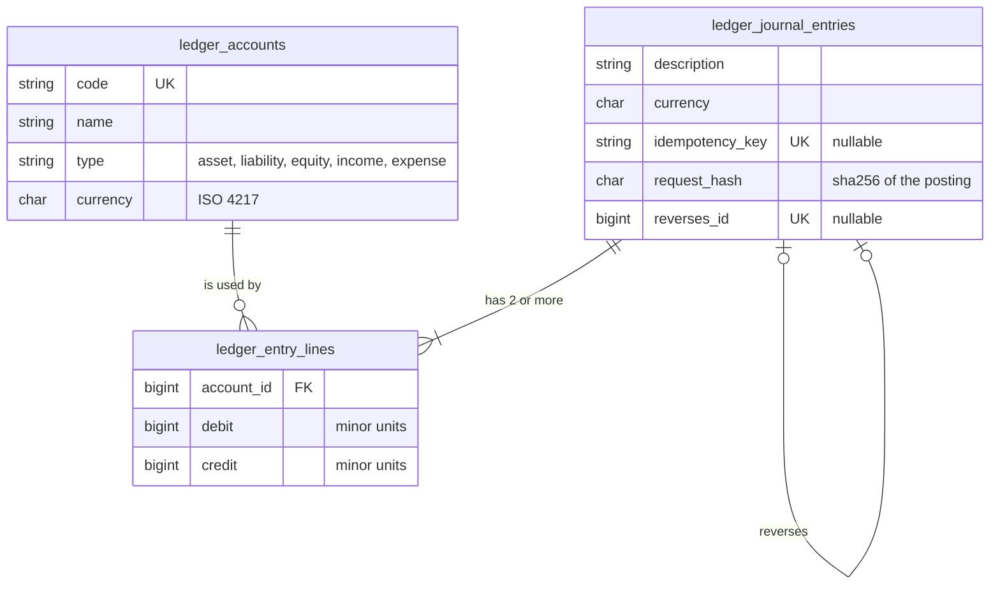

# Laravel Ledger

[](https://github.com/arkhan0072-dev/laravel-ledger/actions/workflows/ci.yml)

Double-entry accounting for Laravel. Every journal entry must balance (debits = credits) or it is rejected before anything touches the database. Money is integer minor units, retries are idempotent, history is never edited, and an `artisan` command audits the books.

## Features

- **Balanced entries only.** Entries with unequal debits and credits, fewer than two lines, mixed currencies or non-positive amounts are rejected with a clear message.
- **Integer money.** Amounts are minor units (cents), so rounding errors from floats never reach the books.
- **Idempotent posting.** Send an idempotency key with a posting (an order ID, a webhook event ID) and a retry returns the stored entry instead of booking it twice.
- **Append-only history.** Posted entries and lines cannot be updated or deleted; mistakes are cancelled with a reversal entry, like on paper.
- **Integrity check.** `php artisan ledger:verify` finds corrupted data written outside the package and exits non-zero, so it can run in CI or a scheduled job.
- **Entry dates and reports.** Book an entry on its accounting date, read any balance as of a past date, and print a trial balance.
- **Works on MySQL, PostgreSQL and SQLite**, tested on all three with PHP 8.3-8.4, with 100% line coverage enforced in CI, PHPStan at max level and Pint.

## Data model



## Usage

Install the package and run the migrations (they are loaded automatically). It is not on Packagist yet; until then, add this repository as a [VCS repository](https://getcomposer.org/doc/05-repositories.md#vcs) in your `composer.json`.

```bash
composer require arkhan0072-dev/laravel-ledger
php artisan migrate
```

### Post an entry

```php
use Arkhan\Ledger\AccountType;
use Arkhan\Ledger\Ledger;
use Arkhan\Ledger\Line;
use Arkhan\Ledger\Models\Account;

$cash  = Account::create(['code' => '1000', 'name' => 'Cash',  'type' => AccountType::Asset,     'currency' => 'USD']);
$sales = Account::create(['code' => '4000', 'name' => 'Sales', 'type' => AccountType::Income,    'currency' => 'USD']);
$vat   = Account::create(['code' => '2100', 'name' => 'VAT',   'type' => AccountType::Liability, 'currency' => 'USD']);

$ledger = app(Ledger::class);

$entry = $ledger->post('Invoice #1042 paid', [
    Line::debit($cash, 12_000),   // $120.00
    Line::credit($sales, 10_000),
    Line::credit($vat, 2_000),
]);

$cash->balance();  // 12000
$sales->balance(); // 10000
$vat->balance();   // 2000
```

`balance()` is positive on each account type's normal side: assets and expenses grow with debits; liabilities, equity and income grow with credits.

Invalid entries throw `Arkhan\Ledger\Exceptions\InvalidEntry`, for example:

```
Debits (1000) must equal credits (999).
All lines must use the same currency, got EUR and USD.
Line amounts must be positive integers (minor units).
```

### Retry safely

```php
// A payment webhook delivered twice is booked once.
$ledger->post('Stripe charge ch_3Pq', $lines, idempotencyKey: 'ch_3Pq');
$ledger->post('Stripe charge ch_3Pq', $lines, idempotencyKey: 'ch_3Pq'); // returns the same entry
```

Reusing a key for a different posting throws `Idempotency key "ch_3Pq" was already used for a different entry.` Line order does not matter when comparing postings.

### Cancel a mistake

```php
$ledger->reverse($entry, 'Customer cancelled');  // posts the mirror entry; balances return to zero
$ledger->reverse($entry);                         // throws: Entry #1 has already been reversed.
$entry->delete();                                 // throws ImmutableRecord
```

### Dates, past balances and the trial balance

Every entry has an accounting date (`posted_at`), which defaults to now and can be set when the
business event happened on another day:

```php
$ledger->post('October invoice', $lines, postedAt: Carbon::parse('2026-10-31'));
$ledger->reverse($entry, 'Credit note', postedAt: Carbon::parse('2026-11-05'));

$cash->balance(Carbon::parse('2026-10-31')); // balance at the end of October
```

A trial balance lists each account's net balance on the debit or credit side for one currency:

```php
$ledger->trialBalance('USD', Carbon::parse('2026-10-31'));
// ['rows' => [['code' => '1000', 'name' => 'Cash', 'type' => 'asset', 'debit' => 125050, 'credit' => 0], ...],
//  'debits' => 125050, 'credits' => 125050]
```

```bash
$ php artisan ledger:trial-balance USD --as-of=2026-10-31
+------+---------+--------+----------+----------+
| Code | Account | Type   | Debit    | Credit   |
+------+---------+--------+----------+----------+
| 1000 | Cash    | asset  | 1,250.50 |          |
| 4000 | Sales   | income |          | 1,250.50 |
|      | Total   |        | 1,250.50 | 1,250.50 |
+------+---------+--------+----------+----------+
Trial balance for USD as of 2026-10-31: debits equal credits.
```

The command exits with status 1 when debits and credits differ.

### Audit the books

```bash
$ php artisan ledger:verify
Ledger OK: 2 entries checked.
```

When data was changed outside the package (raw SQL, a bad import, a manual fix in the database), every problem is listed and the command exits with status 1:

```bash
$ php artisan ledger:verify
Entry #1 does not balance: debits 1500, credits 1000.
Line #4 in entry #1 uses EUR, but the entry is in USD.
Ledger has 2 problem(s).
```

The same check is available in code as `$ledger->verify()`, which returns the list of problems.

## Design decisions

- **Validate first, then write in one transaction.** A rejected entry leaves no rows behind, and a database error mid-write rolls the whole entry back.
- **Balances are derived, not stored.** A balance is the sum of the account's lines, so concurrent postings cannot leave a stale running total, and there is nothing to keep in sync.
- **The database settles races.** Two concurrent retries with the same idempotency key, or two concurrent reversals of one entry, both hit a unique index; the loser gets the stored entry or a clear error, never a duplicate.
- **Idempotency compares the request, not just the key.** A hash of the description and lines is stored with the key, so a bug that reuses a key for a different payment is caught instead of silently returning the wrong entry.
- **One currency per entry.** Currency conversion needs exchange-rate and FX gain/loss accounts and belongs in the application, as two entries.

## Not included yet

- **Database-level immutability.** Updates and deletes are blocked in Eloquent; raw SQL can still change rows (that is what `ledger:verify` catches). Revoking `UPDATE`/`DELETE` from the app's database user or adding triggers closes this.
- **Currencies without two decimal places** (JPY, KWD) are stored correctly but printed by `ledger:trial-balance` as if they had two.
- **Period closing** (locking a month once it is reported).
- **Balance snapshots** for accounts with millions of lines; summing lines is fast with the `account_id` index up to that point.

## Testing

```bash
composer install
vendor/bin/pest                       # tests (SQLite in memory)
vendor/bin/phpstan analyse            # static analysis, max level
vendor/bin/pint --test                # code style
```

Set `DB_CONNECTION=pgsql` or `DB_CONNECTION=mysql` and the usual `DB_*` variables to run the same tests against PostgreSQL or MySQL, as CI does.

## License

MIT
