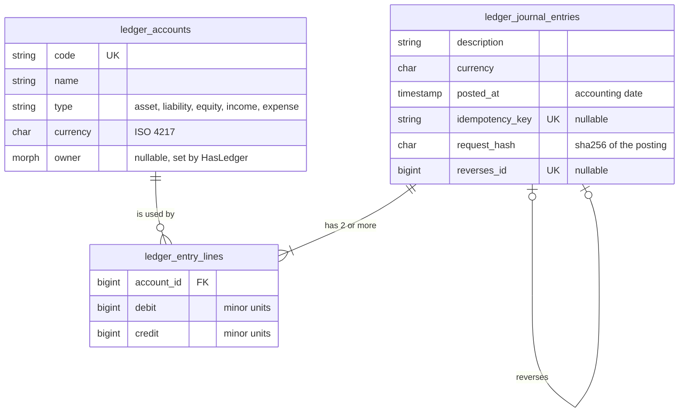

# Laravel Ledger

[](https://github.com/arkhan0072-dev/laravel-ledger/actions/workflows/ci.yml)

Double-entry accounting for Laravel. Every journal entry must balance (debits = credits) or it is rejected before anything touches the database. Money is integer minor units, retries are idempotent, history is never edited, and an `artisan` command audits the books.

## Features

- **Balanced entries only.** Entries with unequal debits and credits, fewer than two lines, mixed currencies or non-positive amounts are rejected with a clear message.
- **Integer money.** Amounts are minor units (cents), so rounding errors from floats never reach the books.
- **Idempotent posting.** Send an idempotency key with a posting (an order ID, a webhook event ID) and a retry returns the stored entry instead of booking it twice.
- **Append-only history, enforced by the database.** Posted entries and lines cannot be updated or deleted, not through Eloquent and not with raw SQL: triggers refuse it on MySQL, PostgreSQL and SQLite. Mistakes are cancelled with a reversal entry, like on paper.
- **Unbalanced entries cannot commit on PostgreSQL.** A deferred constraint trigger checks every entry at commit, so even code that bypasses the package cannot leave the books out of balance.
- **Ledger accounts for any model.** Add the `HasLedger` trait to a user, shop or merchant and call `$user->ledgerAccount('Wallet', AccountType::Liability, 'USD')`.
- **Events.** `EntryPosted` and `EntryReversed` fire after the transaction commits, never for a rolled-back or retried posting.
- **Multi-currency, with real decimal places.** Any number of currencies (one per entry); JPY has none, KWD has three, and reports print each correctly.
- **Integrity check.** `php artisan ledger:verify` finds corrupted data written outside the package and exits non-zero, so it can run in CI or a scheduled job.
- **Entry dates and reports.** Book an entry on its accounting date, read any balance as of a past date, and print a trial balance.
- **Works on MySQL, PostgreSQL and SQLite**, tested on all three with PHP 8.3-8.4 and Laravel 12-13, with 100% line coverage enforced in CI, PHPStan at max level and Pint.

## Data model



## Usage

Install the package and run the migrations (they are loaded automatically).

```bash
composer require arkhan0072-dev/laravel-ledger
php artisan migrate
```

### Post an entry

```php
use Arkhan\Ledger\AccountType;
use Arkhan\Ledger\Ledger;
use Arkhan\Ledger\Line;
use Arkhan\Ledger\Models\Account;

$cash  = Account::create(['code' => '1000', 'name' => 'Cash',  'type' => AccountType::Asset,     'currency' => 'USD']);
$sales = Account::create(['code' => '4000', 'name' => 'Sales', 'type' => AccountType::Income,    'currency' => 'USD']);
$vat   = Account::create(['code' => '2100', 'name' => 'VAT',   'type' => AccountType::Liability, 'currency' => 'USD']);

$ledger = app(Ledger::class);

$entry = $ledger->post('Invoice #1042 paid', [
    Line::debit($cash, 12_000),   // $120.00
    Line::credit($sales, 10_000),
    Line::credit($vat, 2_000),
]);

$cash->balance();  // 12000
$sales->balance(); // 10000
$vat->balance();   // 2000
```

`balance()` is positive on each account type's normal side: assets and expenses grow with debits; liabilities, equity and income grow with credits.

Invalid entries throw `Arkhan\Ledger\Exceptions\InvalidEntry`, for example:

```
Debits (1000) must equal credits (999).
All lines must use the same currency, got EUR and USD.
Line amounts must be positive integers (minor units).
```

### Retry safely

```php
// A payment webhook delivered twice is booked once.
$ledger->post('Stripe charge ch_3Pq', $lines, idempotencyKey: 'ch_3Pq');
$ledger->post('Stripe charge ch_3Pq', $lines, idempotencyKey: 'ch_3Pq'); // returns the same entry
```

Reusing a key for a different posting throws `Idempotency key "ch_3Pq" was already used for a different entry.` Line order does not matter when comparing postings.

### Cancel a mistake

```php
$ledger->reverse($entry, 'Customer cancelled');  // posts the mirror entry; balances return to zero
$ledger->reverse($entry);                         // throws: Entry #1 has already been reversed.
$entry->delete();                                 // throws ImmutableRecord
```

### Accounts for any model

```php
use Arkhan\Ledger\HasLedger;

class User extends Model
{
    use HasLedger;
}

$wallet = $user->ledgerAccount('Wallet', AccountType::Liability, 'USD'); // opened on first use, reused after
$user->ledgerAccounts;                                                    // all of the user's accounts
$wallet->owner;                                                           // the user
```

Each owner has one account per name and currency. Asking for an existing name with a different type throws.

### React to postings

```php
use Arkhan\Ledger\Events\EntryPosted;
use Arkhan\Ledger\Events\EntryReversed;

Event::listen(EntryPosted::class, fn (EntryPosted $e) => Notify::ledgerChanged($e->entry));
Event::listen(EntryReversed::class, fn (EntryReversed $e) => Audit::log($e->reversal, $e->original));
```

Events fire once the surrounding transaction commits. A posting rolled back with your order, or a retry that returns the stored entry, fires nothing.

### Dates, past balances and the trial balance

Every entry has an accounting date (`posted_at`), which defaults to now and can be set when the
business event happened on another day:

```php
$ledger->post('October invoice', $lines, postedAt: Carbon::parse('2026-10-31'));
$ledger->reverse($entry, 'Credit note', postedAt: Carbon::parse('2026-11-05'));

$cash->balance(Carbon::parse('2026-10-31')); // balance at the end of October
```

A trial balance lists each account's net balance on the debit or credit side for one currency:

```php
$ledger->trialBalance('USD', Carbon::parse('2026-10-31'));
// ['rows' => [['code' => '1000', 'name' => 'Cash', 'type' => 'asset', 'debit' => 125050, 'credit' => 0], ...],
//  'debits' => 125050, 'credits' => 125050]
```

```bash
$ php artisan ledger:trial-balance USD --as-of=2026-10-31
+------+---------+--------+----------+----------+
| Code | Account | Type   | Debit    | Credit   |
+------+---------+--------+----------+----------+
| 1000 | Cash    | asset  | 1,250.50 |          |
| 4000 | Sales   | income |          | 1,250.50 |
|      | Total   |        | 1,250.50 | 1,250.50 |
+------+---------+--------+----------+----------+
Trial balance for USD as of 2026-10-31: debits equal credits.
```

The command exits with status 1 when debits and credits differ.

### Audit the books

```bash
$ php artisan ledger:verify
Ledger OK: 2 entries checked.
```

When data was changed outside the package (raw SQL, a bad import, a manual fix in the database), every problem is listed and the command exits with status 1:

```bash
$ php artisan ledger:verify
Entry #1 does not balance: debits 1500, credits 1000.
Line #4 in entry #1 uses EUR, but the entry is in USD.
Ledger has 2 problem(s).
```

The same check is available in code as `$ledger->verify()`, which returns the list of problems.

### Database guards

A migration adds triggers that refuse `UPDATE` and `DELETE` on `ledger_journal_entries` and `ledger_entry_lines`. On PostgreSQL a deferred constraint trigger also refuses to commit any entry that does not balance or has fewer than two lines, whoever wrote it.

On MySQL with binary logging on (the default, and usual on managed databases), a user without `SUPER` may only create triggers when `log_bin_trust_function_creators = 1`. Without it the migration still succeeds, skips the MySQL triggers and logs a warning; set the variable and run the migration again to add them. The Eloquent guards and `ledger:verify` work either way.

## Recipes

Each recipe runs as a test in [`tests/Feature/RecipesTest.php`](tests/Feature/RecipesTest.php).

### Prepaid wallet

A customer's wallet is money you owe them, so it is a liability.

```php
$wallet = $customer->ledgerAccount('Wallet', AccountType::Liability, 'USD');

$ledger->post('Wallet top-up', [Line::debit($stripe, 5_000), Line::credit($wallet, 5_000)], idempotencyKey: 'topup-81');
$ledger->post('Order #12 paid from wallet', [Line::debit($wallet, 1_800), Line::credit($sales, 1_800)]);

$wallet->balance(); // 3200: $32.00 left to spend
```

### Marketplace sale with fees, then a payout

The customer pays $100.00, the card processor keeps $3.20, the platform keeps 10% and owes the seller the rest.

```php
$payable = $seller->ledgerAccount('Payable', AccountType::Liability, 'USD');

$ledger->post('Order #55', [
    Line::debit($stripe, 9_680),
    Line::debit($cardFees, 320),
    Line::credit($payable, 9_000),
    Line::credit($commission, 1_000),
]);

$ledger->post('Payout to seller 3', [Line::debit($payable, 9_000), Line::credit($bank, 9_000)]);
```

### Stripe charges and refunds

Use the Stripe object ID as the idempotency key, so a webhook delivered twice is booked once.

```php
$ledger->post('Stripe charge ch_3Pq', [Line::debit($stripe, 2_500), Line::credit($sales, 2_500)], idempotencyKey: 'ch_3Pq');

// Partial refund: its own entry, keyed by the refund ID.
$ledger->post('Stripe refund re_9Lm', [Line::debit($sales, 1_000), Line::credit($stripe, 1_000)], idempotencyKey: 're_9Lm');

// Full refund: reverse the charge. A second reversal is refused.
$ledger->reverse($charge, 'Refund of ch_4Zx');
```

## Choosing a package

| Package | Pick it when |
|---|---|
| **arkhan0072-dev/laravel-ledger** | You need a small, strict ledger inside your app (payments, wallets, marketplaces), in several currencies, with the database refusing bad data. |
| [ekmungai/eloquent-ifrs](https://github.com/ekmungai/eloquent-ifrs) | You need full IFRS bookkeeping: invoices, VAT, reporting periods and financial statements. |
| [scottlaurent/accounting](https://github.com/scottlaurent/accounting) | You want a simple journal attached to each model with a running balance. |
| [alimrun/laravel-ledger](https://github.com/alimrun/laravel-ledger) | You want single-currency books with parties, periods and reports built in. |

## Design decisions

- **Validate first, then write in one transaction.** A rejected entry leaves no rows behind, and a database error mid-write rolls the whole entry back.
- **Balances are derived, not stored.** A balance is the sum of the account's lines, so concurrent postings cannot leave a stale running total, and there is nothing to keep in sync.
- **The database settles races.** Two concurrent retries with the same idempotency key, or two concurrent reversals of one entry, both hit a unique index; the loser gets the stored entry or a clear error, never a duplicate.
- **Idempotency compares the request, not just the key.** A hash of the description and lines is stored with the key, so a bug that reuses a key for a different payment is caught instead of silently returning the wrong entry.
- **One currency per entry.** Currency conversion needs exchange-rate and FX gain/loss accounts and belongs in the application, as two entries.

## Not included yet

- **Currency conversion entries** with FX gain and loss (planned for 0.3).
- **Period closing**, locking a month once it is reported (planned for 0.3).
- **Commit-time balance check on MySQL and SQLite.** They have no deferred triggers; the package validates before writing and `ledger:verify` audits afterwards.
- **Balance snapshots** for accounts with millions of lines; summing lines is fast with the `account_id` index up to that point.

## Testing

```bash
composer install
vendor/bin/pest                       # tests (SQLite in memory)
vendor/bin/phpstan analyse            # static analysis, max level
vendor/bin/pint --test                # code style
```

Set `DB_CONNECTION=pgsql` or `DB_CONNECTION=mysql` and the usual `DB_*` variables to run the same tests against PostgreSQL or MySQL, as CI does.

## License

MIT
